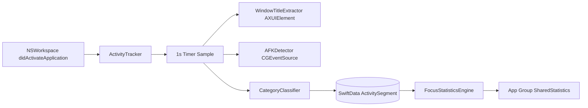

# LifeLogger — Implementation Guide

> macOS 14+ · Swift 6 · SwiftUI · SwiftData · Privacy-First Local Tracking

---

## Quick Start

1. Open `LifeLogger.xcodeproj` in Xcode 16+
2. **Signing & Capabilities** (both targets): App Group `group.com.lifelogger.app`
3. Main target **LifeLogger**: App Sandbox = **OFF**
4. Widget target **LifeLoggerWidget**: App Sandbox = **ON**
5. Run → grant **손쉬운 사용(Accessibility)** and **알림** permissions
6. Raw data path: `~/Library/Application Support/LifeLogger` (0700)

---

## Step 1 — Project Structure & Configuration

### Folder Tree

```
life loging/
├── LifeLogger.xcodeproj/
├── project.yml                          # XcodeGen spec (optional regen)
├── Shared/
│   ├── AppGroupConstants.swift          # App Group keys & UserDefaults
│   ├── ActivityCategory.swift           # 7 categories + focus flag
│   └── SharedStatistics.swift           # Widget ↔ App aggregated stats
├── LifeLogger/
│   ├── LifeLoggerApp.swift
│   ├── Info.plist
│   ├── LifeLogger.entitlements
│   ├── Core/
│   │   ├── Tracking/
│   │   │   ├── ActivityTracker.swift    # ★ Core engine
│   │   │   ├── WindowTitleExtractor.swift
│   │   │   └── AFKDetector.swift
│   │   ├── Models/
│   │   │   ├── ActivitySegment.swift
│   │   │   └── CategoryMappingRule.swift
│   │   ├── Category/
│   │   ├── Statistics/
│   │   ├── Pomodoro/
│   │   ├── Insights/
│   │   └── Sharing/
│   ├── Services/PrivacyDataStore.swift
│   └── UI/
│       ├── Dashboard/
│       ├── Components/LiquidGlassStyle.swift
│       ├── MenuBar/
│       ├── Notch/
│       └── Settings/
└── LifeLoggerWidget/
    ├── LifeLoggerWidget.swift
    ├── ToggleTrackingIntent.swift
    ├── Info.plist
    └── LifeLoggerWidget.entitlements
```

### Info.plist (Main App)

| Key | Value | Purpose |
|-----|-------|---------|
| `LSMinimumSystemVersion` | `14.0` | Sonoma+ |
| `NSAppleEventsUsageDescription` | bloomie 연동 | Apple Events |
| `CFBundleURLSchemes` | `lifelogger` | Deep link |

### Entitlements

**LifeLogger.entitlements** (Sandbox OFF):

```xml
<key>com.apple.security.app-sandbox</key>
<false/>
<key>com.apple.security.application-groups</key>
<array>
    <string>group.com.lifelogger.app</string>
</array>
```

**LifeLoggerWidget.entitlements** (Sandbox ON):

```xml
<key>com.apple.security.app-sandbox</key>
<true/>
<key>com.apple.security.application-groups</key>
<array>
    <string>group.com.lifelogger.app</string>
</array>
```

### `.pbxproj` Critical Settings

| Setting | LifeLogger | LifeLoggerWidget |
|---------|------------|------------------|
| `PRODUCT_BUNDLE_IDENTIFIER` | `com.lifelogger.app` | `com.lifelogger.app.widget` |
| `ENABLE_APP_SANDBOX` | **NO** | YES |
| `SWIFT_VERSION` | 6.0 | 6.0 |
| `SWIFT_STRICT_CONCURRENCY` | complete | complete |
| `MACOSX_DEPLOYMENT_TARGET` | 14.0 | 14.0 |
| `INFOPLIST_FILE` | LifeLogger/Info.plist | LifeLoggerWidget/Info.plist |
| `CODE_SIGN_ENTITLEMENTS` | LifeLogger/LifeLogger.entitlements | LifeLoggerWidget/... |

Embed widget extension via **Embed App Extensions** copy phase (`dstSubfolderSpec = 13`).

---

## Step 2 — Core Tracking Engine

### Architecture



### ActivitySegment Model

```swift
@Model
final class ActivitySegment {
    var id: UUID
    var appName: String
    var windowTitle: String
    var categoryRaw: String
    var startTime: Date
    var endTime: Date?
    var isAFK: Bool
}
```

### ActivityTracker Highlights

| Behavior | Implementation |
|----------|----------------|
| App switch | `NSWorkspace.didActivateApplicationNotification` → close/open segment |
| Sampling | `Timer` every **1 second** |
| AFK | `CGEventSource.secondsSinceLastEventType` default **120s** |
| Privacy | SwiftData at `~/Library/Application Support/LifeLogger/LifeLogger.store` |
| Cloud | `cloudKitDatabase: .none` — **no iCloud** |

Full source: `LifeLogger/Core/Tracking/ActivityTracker.swift`

### WindowTitleExtractor

- `AXUIElementCreateApplication(pid)` → `kAXFocusedWindowAttribute` → `kAXTitleAttribute`
- Fallback: first window in `kAXWindowsAttribute`
- Permission: `AXIsProcessTrustedWithOptions(["AXTrustedCheckOptionPrompt": true])`

Full source: `LifeLogger/Core/Tracking/WindowTitleExtractor.swift`

### 7 Categories & Focus Scoring

| Category | Focus? |
|----------|--------|
| 코딩, 디자인, 문서·글쓰기 | ✅ |
| 커뮤니케이션, 브라우징, 엔터테인먼트, 기타 | ❌ |

**오늘 집중 비율** = `집중 카테고리 시간 ÷ 전체 시간`

Manual rules: **Settings → CategorySettingsView** or `CategoryMappingStore`

---

## Step 3 — Widget & AppIntent

### App Group Contract

Only **refined aggregates** cross the boundary — never raw window titles or full history.

```swift
enum AppGroupConstants {
    static let suiteName = "group.com.lifelogger.app"
    // Keys: isTrackingEnabled, todayFocusRatio, lastSevenDayFocusRatios, ...
}
```

### ToggleTrackingIntent

```swift
struct ToggleTrackingIntent: AppIntent {
    static let title: LocalizedStringResource = "트래킹 토글"

    func perform() async throws -> some IntentResult {
        let defaults = AppGroupConstants.sharedDefaults
        let on = defaults.bool(forKey: AppGroupConstants.Keys.isTrackingEnabled)
        defaults.set(!on, forKey: AppGroupConstants.Keys.isTrackingEnabled)
        WidgetCenter.shared.reloadAllTimelines()
        return .result()
    }
}
```

Main app polls App Group every second in `ActivityTracker.sampleCurrentActivity()` to sync widget toggles.

### Interactive Widget UI

- **▶️ / ⏸️** button via `Button(intent: ToggleTrackingIntent())`
- **7-day trend** via Swift Charts `LineMark` + `AreaMark`
- Families: `.systemMedium`, `.systemLarge`

Full source: `LifeLoggerWidget/LifeLoggerWidget.swift`

### Menu Bar Timer

`MenuBarController` — `NSStatusBar.system.statusItem` shows `● MM:SS` elapsed for current segment.

### Notch HUD

`NotchHUDView` — hover expands slim capsule showing app name, category, timer.  
Open via **Window → Notch HUD** (or add to menu). Position at screen top manually after launch on macOS 14.

---

## Step 4 — bloomie Share & Dashboard

### BloomieShareHelper Flow

```
User taps 􀈂 Share
    │
    ├─ bloomie:// registered? ──YES──► NSWorkspace.open(url)
    │
    └─ NO (fallback)
           ├─ Copy formatted text + URL to pasteboard (⌘V)
           └─ NSWorkspace.open(bloomie) or openApplication(bundleId)
```

**Rules:**
- Only **current activity** (app + window title + category + today's focus %)
- **Never** share full history
- Triggered **only** by explicit share button

Full source: `LifeLogger/Core/Sharing/BloomieShareHelper.swift`

### Liquid Glass Dashboard

| Component | File |
|-----------|------|
| Focus Ring (animated %) | `FocusRingView.swift` |
| Feedback Card | `FeedbackCardView.swift` |
| Activity Timeline | `ActivityTimelineView.swift` |
| Category Bar Chart | `CategoryBarChartView.swift` |
| Glass styling | `LiquidGlassStyle.swift` |
| Integration | `DashboardView.swift` |

### Pomodoro + Golden Time

- **25min focus / 5min break** — `PomodoroTimer.swift`
- Break → auto `pauseForPomodoroBreak()` on tracker
- `UNUserNotificationCenter` local notifications on phase change
- `GoldenTimeAnalyzer` — weekday×hour focus probability → weekly repeating notification (100% local)

---

## Privacy Checklist

- [x] Raw data only in `~/Library/Application Support/LifeLogger`
- [x] Directory chmod **0700**, store file **0600**
- [x] No CloudKit / iCloud / network upload
- [x] App Group shares **aggregates only**
- [x] bloomie share is **opt-in, current snapshot only**
- [x] Sandbox disabled on main app for Accessibility window titles

---

## Build Verification

```bash
cd "/Users/taehyeonkim/Desktop/life loging"
xcodebuild -project LifeLogger.xcodeproj -scheme LifeLogger \
  -destination 'platform=macOS' CODE_SIGNING_ALLOWED=NO build
# → ** BUILD SUCCEEDED **
```

For device distribution, enable signing with your Team ID and register App Group in Apple Developer portal.

---

## Next Steps (Optional)

1. Add App Icon asset catalog
2. Floating Notch HUD via `NSPanel` + `window.level = .floating` (AppKit wrapper for macOS 14)
3. `CFNotificationCenter` for instant widget→app sync (replace 1s polling)
4. Export today's summary as local JSON (still no cloud)
